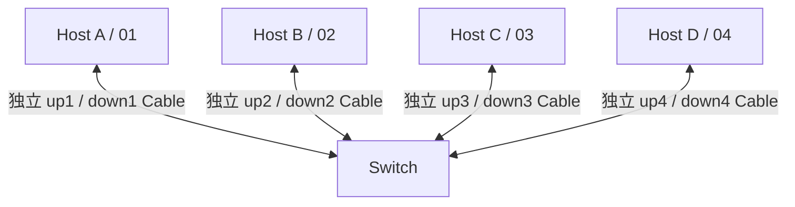

# 架构与执行模型

四个 Host 的地址为 1–4。254 是中央 Switch 的链路报告地址，不是可运行应用的第五个 Host。

`Message.pack → split → Frame.pack + CRC → Hamming(optional) → PHY header → carrier samples → Cable.transmit → decode → CRC → Switch output queue → 全新波形和下行 Cable → Host receive buffer → reassembly → Message.unpack`。

ACK/NACK、窗口更新、探测、LINK_REPORT、应用 RESPONSE 均走同一物理边界。接收端不读取发送端文件或业务字节；交换机只根据通过 CRC 的帧转发。`Network._arrive` 是唯一跨物理边界的入口；`_consume` 是应用交付入口。未知地址不广播，记录事件并最终通过源端重试耗尽暴露失败。

## 时间与线程

`Clock` 用 heapq 和递增事件号维持唯一时钟。每个方向有独立 `PortQueue` 和 busy 状态；一帧结束后才调度下一帧，传播完成时触发接收。同一目的下行串行，不同端口的模拟占用可以重叠。所有事件按 `(time,event_id)` 确定性执行。过期计时器在推进时钟前剔除，不人为拉长完成时间。

每根 Cable 使用单独 `ThreadPoolExecutor(max_workers=1)`。`Network.send/schedule/step/close` 由 RLock 保护，多生产者可以同时提交；可选 `Runner` 用 Queue 和一个引擎线程持续处理命令，stop/join/close 负责清理。UI 使用分步执行，不创建 Runner；500ms 的播放刷新不属于网络时间。

原版 `Cable` 调用全局 `np.random.normal`；适配器在锁中保存/切换/恢复全局 RNG，并为每条方向保留独立状态。实验输入按固定顺序、固定到达时间提交，避免线程调度影响对照。并发生产者提交的相同时间事件按实际获得锁的顺序执行，不能承诺这些提交的逐事件顺序完全复现。

发送占用 `len(waveform) / (48000 / downlink_slowdown)`，上行倍率恒为 1。下行倍率等价于慢 DAC/ADC 时钟；每符号采样点和判决序列不变，载波与符号的实际 Hz 均按倍率降低。`Cable.get_propagation_delay()` 单独加入到达时间。没有用 Python 执行速度代替通信速度。

## 公平调度与自适应

每个输出端口单独队列。Priority 选择最小 priority，同级保持先到；每连续三个 priority<2 帧后，如果存在普通 priority=2 帧则服务最老普通帧。正在发送的单帧不抢占；同一个 flow 所有片段 priority 一致。流控制和累计 ACK 维护顺序。

每个方向独立 AdaptiveController。接收端用固定前导估计增益和线性 SNR、结合 CRC/SECDED 结果生成 3 字节质量报告；报告通过反向 Cable 回到对应发送端。报告失败就不会更新控制器；源端 ACK 超时也记为坏反馈。Auto 只消费这些实际接收的反馈，不读取信道噪声配置。

固定头总是相同保护方式，因此每帧模式独立可解；两个坏反馈、至少 3 帧驻留后增强一档，八个高 SNR 干净反馈恢复一档。故障、拥塞和报告丢失可能使 Auto 保守或反应慢，这由实测结果反映。
